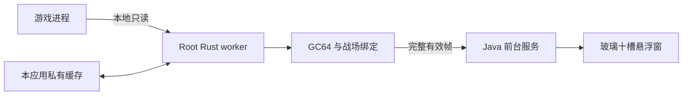

# 对方战斗状态 APK：开发规划与界面方案

日期：2026-10-07。状态：debug APK 已安装到 Android 14 x86_64 `emulator-5554`，冷启动与半透明十槽悬浮面板显示正常；用户允许本次 Root，Rust worker 以 root 身份运行。Root 提示框遮挡问题、错误线程覆盖状态和收起面板被自动展开的问题均已修复；集成脚本通过，CodeRabbit 最终复审 28 个文件、0 issues。曾在战斗画面测试，但面板仍显示“正在定位”，没有完整战斗帧或 HP/MP/SP；应用缓存目录没有 `manager-cache-v1`。游戏之后显示连接服务器失败，当前无法继续测战斗数据。

## 1. 产品目标

独立安装在模拟器里的战斗观察 APK。用户打开后显示可拖动、可收起的半透明玻璃面板，在固定十个对方槽位显示 HP、MP、SP（速度）。数据在模拟器本地读取；电脑用于开发和安装，不作为运行时数据源。

首次使用完成悬浮显示授权与本应用读取权限检查；随后后台读取、游戏上方显示。无有效样本时明确显示未进战、正在定位或读取失败，过期值不继续标为实时。默认不做开机自启动或发包控制。

## 2. 已查证的基础

| 项目 | 当前证据 | 对方案的影响 |
| --- | --- | --- |
| 旧小黑 Android 源码 | `mobile/`，原生 Java；`OverlayService.java` 有拖动、悬浮球收起、位置保存、半透明窗口 | 参考外观和悬浮交互，保持旧应用与预设业务独立 |
| 旧 APK 数据源 | `WpeSyncClient` / `SyncCoordinator` 使用电脑 `/MobileSync/*` | 尚无战斗数据源，不直接接入现有预设协议 |
| 现有 Python 面板 | HP / MP / `m_Speed`、两侧十槽、一致性检查已实现；同进程缓存与实际窗口已验证 | 迁移已确认的字段和绑定规则，保留其校验语义 |
| 新进程定位 | 游戏重启后的冷定位速度与可靠性尚未验收 | 列为读取路线的首要验收项，不宣称已有永久指针 |
| 当前模拟器 | 只读查询：Android 14 / API 34 / x86_64 | 首次 native helper 以 x86_64 为实际目标；其他 ABI 单独验证 |
| 玻璃能力 | `wm disable-blur` 无参数只读查询：supported=true，enabled=true | Overlay Service 的公开模糊接口会模糊整个窗口后方；本 APK 使用半透明底色和亮边，不启用整窗模糊 |
| 本机工具 | Android SDK platform 35、NDK 27.2.12479018、临时 Java 17 和 Rust `x86_64-linux-android` target | `assembleDebug` 已成功；JDK 只用于本次构建，未修改全局环境 |
| 新 APK 源码 | `mobile-battle-panel/`：独立 Java UI、EBP1 帧协议和无第三方 crate 的 Rust worker | x86_64 Rust ELF 已随 APK 打包；Root 执行与游戏数据未在设备上验收 |
| APK 内 Python | 旧工程未发现 Python runtime 配置或战斗内存解析器 | 不把 Windows Python 脚本直接当作 APK 运行能力 |

现有 `mobile/app-debug.apk` 是旧文件；本轮没有检查其内部版本或证明它与当前源码一致。

## 3. 推荐语言与架构

**Java 做 APK 主体和悬浮界面，Rust 做独立的 Root 只读 worker。**

Java 复用旧工程熟悉的原生 View / WindowManager 路线，处理应用生命周期、授权引导、前台服务、拖动、收起、主题设置和 UI。Rust worker 负责进程发现、只读字节读取、GC64 解析、定位与完整帧输出。Root worker 是独立子进程：普通 APK 进程不会因加载 native 库而自动获得读取其他进程的权限。

Rust 适合实现字节解析、缓存和后台读取，可降低读取器自身的内存管理错误；操作系统接口中必要的 unsafe 边界保持小范围。它不会自动解决目标地址失效、Root 权限或战场识别，也不能仅凭语言保证扫描更快。Rust 官方支持当前模拟器对应的 `x86_64-linux-android` 目标，通过 Android NDK 交叉编译。[Rust Android 目标文档](https://doc.rust-lang.org/rustc/platform-support/android.html)

本机 `.cargo/bin/` 已找到 `rustc.exe`、`cargo.exe` 和 `rustup.exe`，`rustc --version` 为 1.96.1；命令没有加入当前 PATH。当前已安装 `x86_64-linux-android` target，并使用 NDK `x86_64-linux-android23-clang.cmd` 成功构建 worker。

Root worker 与服务通过有长度边界的本地 stdin/stdout 通信，诊断与帧分开。采用协作取消和确定的退出清理；仅打开目标进程只读数据，不提供写入、注入或游戏方法调用接口。实现时核实 Android 对可执行文件部署位置的限制，不能默认 app 私有目录内任意 ELF 都能执行。

已创建独立 Android 工程 `mobile-battle-panel/`，应用包名与缓存目录独立，与旧小黑共存。旧 `mobile/` 仅作 UI 参考；没有复制预设动作、认证账号、MobileSync 控制或可变业务策略。

## 4. 读取规则与缓存

- 每次重新绑定 package、PID、startTicks、executable，以及当前 BattleId、round、本地角色和位置表。读取器不能把“非本地对象”全部当作对方。
- 保留 GC64 的绝对环境 GCRef、array 第零项和 hash 节点处理。对方仅为已确认的主位五槽与宠物五槽；第三位置组和辅助对象排除。
- 槽位使用真实 position ID，界面根据两侧已确认坐标适配朝向。空槽和死亡单位保留位置，SP 读取 `m_Speed`。
- 每轮建立新的页缓存；结束检查重新读进程身份、战场、回合、表引用与位置字典。有变化就丢弃整帧，UI 不显示旧数据为实时。
- **会话地址缓存**：候选 manager 地址只在同一进程身份下复用，使用前验证；进程重启使旧地址失效。
- **跨重启定位规则**：研究可验证的稳定入口、模块相对引用或可缩小扫描范围的结构特征，按游戏版本、ABI 和解析版本隔离。当前尚未找到或验证稳定指针链；规则失效时有界回退发现，不重复使用旧绝对地址。
- 采样放在后台，UI 只消费最新有效帧。首期采样目标约每秒一轮，实际周期由读取耗时与资源占用决定，不把目标写成已达到的性能。

## 5. 界面设计

采用 `frontend-design-direction` 技能，并参考旧 APK 的暗色面板、细亮边、悬浮球和收起方式。设计预览在同目录 `design-preview.html`；它只展示效果，不连接读取器或 APK，HP / MP / SP 都为“—”。

- 烟灰半透明玻璃，默认背景浓度约 62%，细高光边和浅阴影；内容文字保持清晰，不把整组文字一起降低透明度。
- 淡青用于状态和边缘强调；HP 淡绿、MP 淡蓝、SP 琥珀。字段保留文字标签，信息不只靠颜色表达。
- 横屏默认放在屏幕一侧，约占宽度四成，可拖到其他位置并记忆。十槽保持两列平行斜排的主五与宠五，主位序号与原始槽位的关联稳定。当前 HTML 是紧凑排版示意；APK 以实际两侧位置表决定朝向，不把预览像素坐标当作游戏坐标。
- 上方只保留拖动把手、标题、读取状态与收起按钮。尺寸和背景浓度放在设置中，不占战斗时的主要读数区域。
- 小悬浮球负责展开/收起。收起不显示过期数据；后台采样可降低频率以减少负担，展开后重新取有效帧。
- 空槽显示“空槽”，死亡显示“已死亡”；未进战、定位中、权限不足、读取失败、过期各有独立状态，不用 0 代替未知值。

悬浮窗服务无法用公开 API 只模糊面板后方；`blurBehindRadius` 会影响整个窗口后方，因此首版不启用。APK 使用 62% 不透明主底色、边缘高光和清晰文字。[Android WindowManager 文档](https://developer.android.com/reference/android/view/WindowManager.LayoutParams)、[Android Window 文档](https://developer.android.com/reference/android/view/Window)

首版优先保证面板外的游戏区域可以正常操作、面板可以拖动和收起。不把透明背景当成触摸穿透；若后续加入锁定穿透模式，需要单独处理窗口 alpha、系统遮挡阈值与恢复操作的悬浮球。[Android 12 触摸遮挡规则](https://developer.android.com/about/versions/12/behavior-changes-all#untrusted-touch-events)

## 6. 实施阶段与验收

| 阶段 | 产出 | 验收条件 |
| --- | --- | --- |
| 0：本地读取可行性 | 最小 APK、独立 Root worker、x86_64 APK build | APK 已安装；一次性 Root 授权后确认 `su -c` worker 以 root 身份运行。目标内存读取结果仍待有效战斗帧确认 |
| 1：解析与重新定位 | GC64 / 十槽 / app-private manager 候选缓存 | 代码已构建；在模拟器战斗画面仍未得到有效帧，cache 目录没有 manager 候选；游戏重启冷定位速度尚未实测，地址缓存不是永久指针 |
| 2：玻璃悬浮窗 | 可安装的 Java 界面版本 | 模拟器已显示十槽半透明面板；Root 对话框无遮挡、扩展/收起正常，扫描更新后仍保持收起；Root 提示集成脚本通过 |
| 3：接通真实数据 | 独立运行 APK | Java/Rust 帧桥和 Root worker 已运行；当前战斗画面没有有效数据帧，真实 HP/MP/SP、换回合、死亡和空槽状态尚未验收 |
| 4：交付检查 | APK、校验值、使用说明 | Gradle 构建、模拟器安装启动和 CodeRabbit 复审通过（28 个文件、0 issues）；设备冷定位与长时间采样未验收 |

核心代码和可安装 debug APK 已完成；模拟器已安装并运行，悬浮显示权限已允许，Root 管理器已批准本次读取。战斗画面测试时，面板仍显示定位中且应用缓存目录没有 `manager-cache-v1`；游戏随后显示“连接服务器失败，请重新登录”。因此当前只确认 APK、Root worker 与悬浮界面启动。下一步恢复有效战斗后需先定位为何没有完整战斗帧，再验证回合刷新与游戏进程重启后的冷定位。

## 7. 多代理分工

开发本轮由 Java UI 开发代理和 Rust worker 开发代理分别独占目录并行实现，主代理完成 Gradle/NDK 集成、构建和 CodeRabbit 审查。Jev 判断代理两次返回 `LOW_CONFIDENCE` / `not_run`，计划和结果不以它作为放行依据。

后续模拟器验收只针对独立新包和只读路径；已确认 ABI、Root 本次允许、root worker 与悬浮面板启动，Root 对话框遮挡脚本通过，收起状态在读取更新后保持。CodeRabbit 最终覆盖 28 个文件并报告 0 issues。仍需确认 manager 发现、有效战斗帧、回合刷新与进程重启冷定位；任何未执行项明确标记为未验证。

## 8. 权限与待确认项

悬浮显示需要系统 `SYSTEM_ALERT_WINDOW`，现有工程已有相关流程。常驻展示使用前台服务，服务类型及声明参考已存在的 `specialUse` 实现，并根据最终目标 SDK 核对。[窗口类型](https://developer.android.com/reference/android/view/WindowManager.LayoutParams#TYPE_APPLICATION_OVERLAY)、[前台服务类型](https://developer.android.com/develop/background-work/services/fgs/service-types#special-use)

Root 管理器一次性允许与 worker 的 root 身份已验证；目标 `/proc/<pid>/mem` 的成功读取、游戏重启定位性能、正式签名与发布构建仍未验证。Android SELinux 也会约束 Root 进程，不能仅以设备有 Root 推定任意应用能读取游戏内存；本方案不把修改系统安全策略作为默认实现。[AOSP SELinux](https://source.android.com/docs/security/features/selinux)
